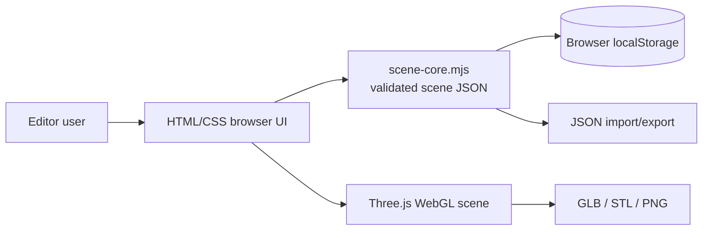
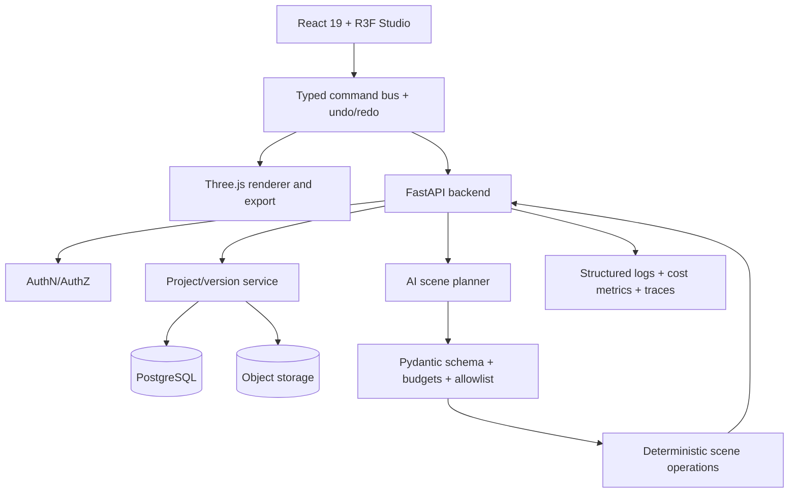

# Production architecture and agent design

## Current prototype



The current prototype's scene core is pure JavaScript and testable with Node's built-in test runner. Rendering and DOM event logic lives in `src/main.js`. The Three.js version is pinned in the import map to avoid accidental CDN upgrades; bundling is a priority for Codex.

## Phase 2 target



### Key design decision

**All scene editing goes through a typed command bus.** Do not let components modify raw Three.js objects as the sole source of truth. The renderer must be a projection of the validated scene model.

Example operation:

```json
{
  "op_id": "op-123",
  "type": "add_primitive",
  "arguments": {
    "kind": "cylinder",
    "name": "Lamp base",
    "position": [0, 0.15, 0],
    "scale": [1.5, 0.3, 1.5],
    "material": {"color": "#8B8B9B", "metalness": 0.65, "roughness": 0.28}
  }
}
```

### AI agent roles, bounded scope

- **Intent interpreter**: classify user request into allowed operations, identify missing dimensions, produce structured plan.
- **Scene planner**: produce a list of primitive objects, transforms and materials, with short explanations.
- **Validator**: Pydantic schema and deterministic business validation including object count caps, finite bounds, supported geometry and color formats. This is code, **not** an LLM role.
- **Compiler**: atomically apply accepted operations on a cloned scene, render preview; transaction rollback on failure.
- **Quality checker**: validate nonempty scene, coordinate bounds, collisions when applicable, output size and frame-time budget. Never claim structural/printability guarantees without dedicated geometry checks.

A single model invocation implementing interpreter/planner is a better MVP than multi-agent complexity; add specialized subagents only when evaluation shows a measurable advantage.

### Example API

- `POST /v1/ai/scene-plans` — prompt → structured proposed operations; include model/version, estimated token cost, user confirmation requirement.
- `POST /v1/scene-plans/{id}/apply` — validate allowed operations, version precondition and scene ownership, return new version.
- `GET /v1/projects` — paginated, authenticated list.
- `POST /v1/projects` — create scene with safe defaults.
- `GET /v1/projects/{id}` — owner/editor access.
- `PATCH /v1/projects/{id}` — optimistic concurrency via version or ETag.
- `POST /v1/projects/{id}/exports` — export job; use signed artifact URL.

### Data model

- `projects`: id, owner_id, name, created_at, updated_at, current_version.
- `scene_versions`: id, project_id, version, scene_json, created_at, created_by, parent_version.
- `scene_operations`: id, project_id, version, actor, operation_json, timestamp.
- `assets`: id, project_id, object_storage_key, content_type, bytes, sha256, scanned_at.
- `ai_runs`: id, user_id, prompt_hash, model_name, run_status, tokens_in, tokens_out, duration_ms, validation_errors_count.

Never store raw prompt contents in telemetry by default. Rotate signed URLs; enforce auth on asset ownership; validate GLB uploads to avoid oversized resource and shader abuse.

## Reliability and performance requirements

- e2e interactions: create shape, select, inspector transform, undo, redo, save/import JSON, export GLB and re-open imported model in a second Three viewer.
- Unit tests for deterministic parser, project round-trips, geometry validation, ID uniqueness, operation inversion, version conflicts.
- Avoid unbounded camera/render changes, network-dependent textures and unbounded AI requests.
- Suggested **targets to measure** (not current achievements): usable scene in under 3 seconds over modern broadband, 30+ FPS for 100 primitive objects on a midrange desktop, editor import limit 10 MB after asset support, under 1% failed exports in a monitored beta.

## Development sequence

1. Verify and fix WebGL runtime and export flows in the prototype.
2. Convert core model to TypeScript and introduce Vite, React 19, R3F v9 and tests.
3. Refactor to typed command bus; add layers hierarchy, grouping, multi-select.
4. Add GLB import, scene thumbnails, exporting from loaded assets.
5. Add FastAPI/Pydantic server with local JSON and PostgreSQL adapters.
6. Implement controlled AI scene planner with quotas and evaluation set.
7. Add authentication and per-project share permissions.
8. Add accessibility passes, performance probes, CI, deployed preview and user feedback.
